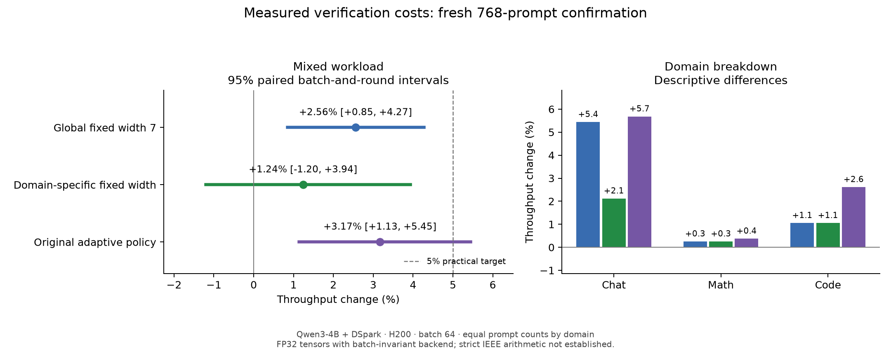
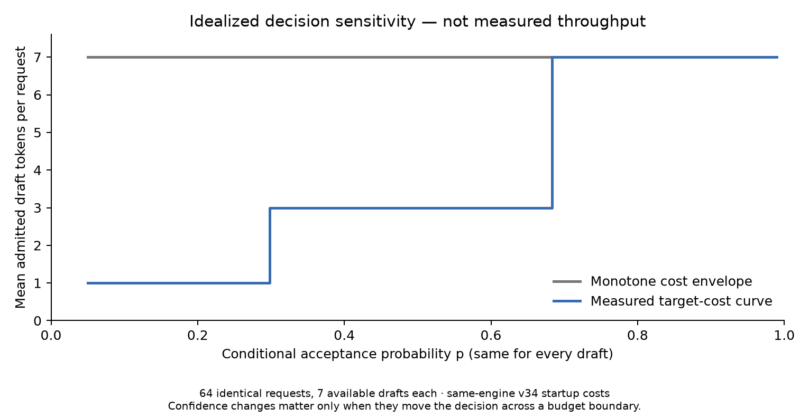

# Adaptive verification for speculative decoding

Experiments by **Angelina Quan** on confidence-based verification lengths for an open-weight LLM.

## Latest: confirmed batch-dependent draft-width effects (v76)

[Updated four-page project report](output/pdf/project_report.pdf) · [Editable LaTeX](reports/project_report.tex). The report covers the new research question, related work, proposed profiling method, confirmed results, and limits of generalization.

On **768 fresh-to-our-runs prompts**, native DFlash2 width 3 was **29.75% faster than width 8 at batch 64**. At batch 8 the direction reversed: width 8 was **34.76% faster than width 3**. This supports a practical configuration-tuning study; it is not a new adaptive algorithm or a calibration gain.

| Batch | Width 3 tokens/s | Width 8 tokens/s | Faster configuration | Throughput gain, 95% paired bootstrap CI |
|---|---:|---:|---|---:|
| 8 | 1,240.31 | 1,671.41 | Width 8 | **34.76% [33.01, 36.49]** |
| 64 | 9,146.79 | 7,049.68 | Width 3 | **29.75% [26.81, 32.61]** |

All four engine orders agreed. All 18 sessions completed; **3,888 batch-output checks** matched ordinary greedy decoding, including warmups. Ordinary-decoding outputs agreed across batch sizes. Independent local analysis reproduced the remote summary exactly. The protocol used two warmup and two timed workload passes per session, Qwen3-4B with the released DFlash2 drafter, BF16, a 64-token generation cap, and one H200. Widths were fixed before inspecting these prompts.

The batch-64 benefit was 37.03% on Alpaca, 19.98% on GSM8K, and 30.55% on MBPP. At batch 8, width 8 gained 24.60%, 53.82%, and 32.60%, respectively. Bootstrap intervals resample engine rounds and contiguous 64-prompt blocks within domains; they do not quantify generalization across GPUs or model pairs. MBPP includes previously unused tasks from all official partitions; freshness to our experiments does not imply absence from model training data.

Only widths 3 and 8 were confirmed here. Width 3 was selected from the earlier native batch-64 width sweep; these results do not establish global optimality or a gain over the best batch-specific fixed configuration. This is offline batched inference, not a measured live load-switching policy. Batch-dependent draft selection and lookup tables are established prior work; see the literature review for attribution and the proposed profiling-reliability/transfer study.

[Results, compressed raw sessions, and audit](results/v76/) · [Frozen protocol](experiments/load_v76_plan.json) · [W&B](https://wandb.ai/aquan-world-model/18657-speculative-pilot/runs/0arn12x7) · [Literature and project framing](reports/batch_width_related_work.md).

## Earlier verification-cost and calibration studies

**Expanded result:** keeping the measured verification-cost curve improves throughput over globally tuned fixed widths and native adaptive verification in two balanced studies. The gains are modest; online calibration did not cause them.

| Batch | Prompts | vs tuned global fixed | vs native adaptive |
|---|---:|---:|---:|
| 32 | 384 | **+1.25%** [0.90, 1.59] | **+1.35%** [1.07, 1.63] |
| 64 | 768 | **+2.56%** [0.85, 4.27] | **+3.17%** [1.13, 5.45] |

Brackets give 95% paired batch-and-round bootstrap intervals. Every output matched its ordinary-decoding reference across all 16 sessions in each study. At batch 64, improvement over the stronger domain-specific fixed baseline is **+1.24% [−1.20, 3.94]**, which is not statistically established. The larger 5% target and exploratory 10–15% effects were not confirmed.

[Earlier verification-cost report](output/pdf/verification_cost_report.pdf) · [Earlier report LaTeX](reports/verification_cost_report.tex) · [Two-page results report](output/pdf/cost_study.pdf) · [Editable LaTeX](reports/cost_study.tex) · [Report-ready CSV](reports/cost_evidence.csv) · [LaTeX table](reports/cost_evidence_table.tex) · [Claims and limitations](reports/cost_evidence.json) · [Table-generation script](scripts/summarize_cost_evidence.py).

**Completed scope:** the two expanded studies above are packaged in the results report. The targeted batch-128 sweep passed all output checks but did not qualify for expansion: measured costs gained **2.09%** over native adaptive and lost **4.10%** against the best fixed width (3). The sweep reused 384 prompts and had unbalanced engine order, so these are exploratory estimates. All widths 1–7 were tested; the negative comparison is retained. [Batch-128 results](results/v48/). New stochastic and calibration branches remain deferred.

This repository reproduces **vLLM's existing adaptive-verification implementation** with a released DSpark drafter. It does not claim that the scheduler is new, or that online calibration caused these gains. The broader project asks whether online confidence calibration under workload shifts can improve verification decisions; that contribution remains unproven.

**Earlier v16 correctness failure (preserved):** the fresh 96-prompt run stopped before speculative timing: fixed width 3 at batch 8 differed from ordinary greedy decoding on one prompt (index 88, GSM8K item 901), starting at output token 26. Both outputs reached the 128-token cap. That run established no speedup; the subsequent numerical diagnostics and fresh v26 comparison are reported below. [Preserved outputs](results/v16/incomplete/) · [failed correctness run](https://wandb.ai/aquan-world-model/18657-speculative-pilot/runs/nue79syr).

The diagnostic reproduced the same single mismatch in two complete repeats. At the first divergence, the target log-probability gap between ` a` and ` enough` changes from +0.000469 in ordinary decoding to −0.002220 in speculative execution. This is consistent with numerical sensitivity between execution paths, but does not establish the root cause or satisfy the strict output-equality gate. [Diagnostic outputs and summary](results/v19/).

**Batch-invariant diagnostic:** enabling `VLLM_BATCH_INVARIANT=1` with Triton attention produced identical ordinary and fixed-width-3 outputs on all 96 prompts in both repeats (192 paired comparisons). This resolves the reproduced mismatch for that configuration; it is not a timing result or a check of the adaptive/calibration extension. The changed numerical configuration requires fresh baselines. [Diagnostic results](results/v20/) · [W&B](https://wandb.ai/aquan-world-model/18657-speculative-pilot/runs/f6ty5txm).

**Precision qualification:** the serving studies request FP32 tensors and set `NVIDIA_TF32_OVERRIDE=0`. A later inspection found cached batch-invariant Triton persistent-matmul kernels containing TF32 instructions despite that setting. This is not proof that every cached kernel executes in every timed step; complete kernel attribution remains unaudited. Accordingly, these results must not be described as globally strict IEEE FP32 arithmetic. The frozen comparison uses the same backend settings for all methods and checks token equality against its ordinary-decoding reference. Historical configuration files retain their original requested settings; this note corrects any stronger interpretation of “TF32 disabled.”

## Larger-vocabulary recovery screen (v60)

On 48 reused prompts at batch 8 and width 7, recency-16,384 gained **3.66%** over native full-vocabulary decoding (orders **3.62% / 3.69%**). Recency-4,096 gained **1.96%**; prompt-only-16,384 lost **1.81%**. All projection, target-invariance, buffer, output, and provenance gates passed; independent local analysis exactly matched the remote summary. These are exploratory results, not significance or fresh-confirmation claims. No candidate met the >10% expansion gate.

The source prior contains only 5,738 observed token types; the 16,384-token source initialization includes 10,646 zero-frequency fill entries. Recency is a prior-inspired baseline, not a novel prefix-weighted algorithm. The previously reported 17.59% future-output oracle can also change acceptance by excluding wrong draft choices; it is not a projection-only ceiling. The completed diagnostic (v61) confirms higher oracle acceptance: conversation steps fall from 86 to 77, math from 52 to 51, and code from 67 to 62. All output/projection checks pass. This is instrumented mechanism evidence, not a new throughput result. [Diagnostic and decision](results/v61/) · [W&B](https://wandb.ai/aquan-world-model/18657-speculative-pilot/runs/60d426bm).

[Raw sessions and audited results](results/v60/) · [W&B audit](https://wandb.ai/aquan-world-model/18657-speculative-pilot/runs/7v6j6ei1) · [Current six-page research report](output/pdf/research_status.pdf) (snapshot through v59).

## Larger-gain exploration at batch 64 (v29)

Following the 1.25% held-out gain, the batch-64 exploratory sweep reused the 384 v26 prompts explicitly as exploratory data and retuned all fixed widths 1–7 with a graph-capture limit of 512. All ten methods passed output checks against a fresh batch-64 ordinary-decoding reference; independent local analysis matched the remote audit and verified execution-source hashes.

| Method | Tokens/s |
|---|---:|
| Ordinary decoding | 3,081.57 |
| Fixed 1 | 4,693.89 |
| Fixed 2 | 5,255.04 |
| Fixed 3 | 5,927.84 |
| Fixed 4 | 5,466.00 |
| Fixed 5 | 5,551.55 |
| Fixed 6 | 5,683.61 |
| Fixed 7 (best fixed) | 6,070.69 |
| Original adaptive cost model | 6,053.18 |
| Measured-cost variant | 6,354.71 |

Measured cost improved **4.68% over the best fixed width** and **4.98% over the original adaptive policy**. This does **not** pass the exploratory 5% gate. Relative to fixed 7, domain changes were **+11.31% chat, +0.45% math, and +0.88% code**. The chat number is not the aggregate result. Engine order was unbalanced and prompts were reused, so no significance or new held-out claim is made. A larger effect still requires frozen, balanced confirmation on unused prompts. Numerical-precision qualifications above apply.

[All raw results and audited summary](results/v29/) · [W&B audit](https://wandb.ai/aquan-world-model/18657-speculative-pilot/runs/xq6bb2sz).

A separate causal-history screen (v31) tested whether previous verification residuals help forecast the next block. On old temperature-1 traces, the best of three reported EWMA rates reduced average Brier error only about **0.1%** versus the source-fitted no-history mapping (0.112413 versus 0.112531). This small exploratory change is not serving-speed evidence. [All rates, fits, and checks](results/v31/) · [W&B](https://wandb.ai/aquan-world-model/18657-speculative-pilot/runs/kwn91k1d).

The calibration pilot (v32) completed with all output checks passing. At batch 64 with measured costs, frozen source calibration improved throughput **0.28%** over identity confidence; online updates improved only **0.04%** over identity and were **0.24% slower than frozen** (negative in all three balanced rounds). All methods shared the same extension, with diagnostic scoring removed. This is another negative result for a material online-calibration benefit. It is a descriptive single-engine pilot on reused prompts, not a fresh test. [Plan](experiments/head_cost_v32_plan.json) · [raw results and summary](results/v32/) · [W&B audit](https://wandb.ai/aquan-world-model/18657-speculative-pilot/runs/upe3wcco).

A runtime-cost diagnostic (v30) failed because the upstream event collector closes events only for dummy profiling calls; it returned no actual-serving timing samples. [The failed artifact is preserved](results/v30/runtime_cost_v30_failed.json). The corrected v33 diagnostic completed with all output checks passing. After retaining one initial unbudgeted step per call separately, all 495 budget/event records matched request and token counts. [Diagnostic traces and summary](results/v33/) are instrumented GPU-event measurements, not throughput evidence.

Preserving the raw draft-cost curve as well (v34) did not yield a consistent additional benefit: the gain over target-only costs was +0.004%, +4.477%, and −0.277% across three rounds. Its +1.41% pooled mean is driven by one slow target-only block; no observations were removed, and this variant is not selected as an improvement. [Raw timings and audit](results/v34/) · [W&B follow-up audits](https://wandb.ai/aquan-world-model/18657-speculative-pilot/runs/ooxnrxyk).

A stronger post-hoc comparator selects a separate fixed width per domain from the same exploratory sweep. Chat's best fixed width is 3; measured cost is **10.40% faster** than it, versus 11.31% over the globally selected fixed 7. Math and code both select fixed 7. [All domain-specific rates](results/v29/cost_v29_domain_oracles.json). This helps identify a promising regime but is not fresh confirmation.

The subsequent experiment (v37) kept the native total budget but weights allocation toward requests with less already-generated progress, testing finite-batch tail behavior. It uses no future acceptance or response length. The first integration attempt (v36) passed 33 compiled-GPU allocation tests but failed live-manager binding before inference or timing; [the failure is preserved](results/v36/lag_v36_failed.json). The corrected v37 run passed all 33 GPU allocation checks and all output checks. It gave **−0.006%** and **+0.030%** overall for strengths 1 and 4, respectively, versus the shared-overhead identity control: no material improvement. [Plan](experiments/lag_v37_plan.json) · [all results](results/v37/).

The completed fresh confirmation (v38) was frozen before generation: 768 unused prompts, equal counts from chat/math/code, batch 64, four balanced engine orders, and two timed repeats per session. It retains the minimal target-cost-only method. Both fixed widths 3 and 7 run on every prompt; the stronger domain-specific comparator uses the previously selected width 3 for chat and 7 for math/code. The primary practical target remains at least 5% overall against that comparator, global fixed 7, and the original adaptive scheduler, with positive round gains and both bootstrap lower bounds above zero. V29's 4.68% exploratory result missed its 5% target; this independent confirmation is warranted by the larger effect, not by reclassifying v29 as a pass. A chat-only gain cannot substitute for primary mixed-workload success.

The code source expands from MBPP's sanitized 257-test subset to its full official 500-test split (task IDs 11–510), excluding previously used task IDs across edited descriptions as well as normalized text. The [frozen plan](experiments/cost_v38_plan.json), [manifest](experiments/cost_v38_manifest.json), benchmark, and analyzer are published before inference. The completed results follow; no changes were made to the frozen success criteria.

## Fresh batch-64 confirmation (v38)

The **5% mixed-workload target failed**. All four round gains were positive for each comparator, but the domain-specific comparison has an interval crossing zero. Local analysis exactly matched the remote audit; all 768 outputs matched the ordinary-decoding reference in all 16 sessions, and every warmup/timed pass enforced output equality. All eight adaptive target tables were independently reconstructed from their raw profiling samples and matched exactly across positions 0–512.

| Comparator | Throughput gain | 95% batch-and-round interval |
|---|---:|---:|
| Global fixed width 7 | +2.56% | +0.85% to +4.27% |
| Prespecified domain-specific fixed width | +1.24% | −1.20% to +3.94% |
| Original adaptive policy | +3.17% | +1.13% to +5.45% |

Measured-cost throughput was 6,250.80 tokens/s, versus 6,095.03 for fixed 7, 6,174.37 for the domain-specific comparator, and 6,058.87 for original adaptive. Domain changes against the prespecified domain baseline were **+2.12% chat, +0.25% math, and +1.05% code**. The exploratory 10.40% chat improvement against fixed 3 did not reproduce at that magnitude on fresh prompts. These are descriptive domain estimates, not separate confirmed successes.



[All raw sessions, summary, and independent table audit](results/v38/) · [W&B complete audit](https://wandb.ai/aquan-world-model/18657-speculative-pilot/runs/az4k5l1i) · [Statistical analyzer](experiments/analyze_cost_v38.py) · [Independent table reconstruction](experiments/audit_cost_tables_v38.py).

The study has only four prompt batches per domain and four engine rounds, one model pair, and one hardware/backend configuration. The MBPP source expansion and numerical-precision qualifications above remain relevant. These results support a modest cost-model effect, not a substantial online-calibration contribution. Further tuning on these 768 prompts would be exploratory, not another fresh confirmation.

A further pilot (v39) tested whether CPU budget selection suffers from stale confidence inputs. Synchronizing the latest existing host copy changed only **1 of 243** diagnostic budget decisions and made throughput **3.12% worse**; all four round differences were negative. The latest host values exactly matched current GPU confidence in the diagnostic, all 78 batch-level output checks matched the reference, and independent budget replay passed. Thus stale confidence is not a promising bottleneck in this workload. [All exploratory results](results/v39/) · [W&B run](https://wandb.ai/aquan-world-model/18657-speculative-pilot/runs/8ryeqsi7). These reused-prompt timings include synchronization overhead; the separate instrumented diagnostic is not speed evidence.

A full-verification diagnostic (v40) then recorded predictions before verification feedback on the same reused 384 prompts. All outputs and slot/capacity/acceptance alignment checks passed. On 238 pure-decode states with complete seven-position feedback (8 other states excluded), a post-hoc perfect-information allocator improved the **accepted-token/profile-cost proxy** by only **2.08% overall** over head-based decisions: **5.89% chat, 0.25% math, 0.65% code**. This is **not a measured speedup or a closed-loop upper bound**: policies change future states, profiling is approximate, and sampler counts precede EOS/output truncation. Nevertheless, the small proxy headroom weakens the case for further confidence-only tuning in this greedy workload. The oracle uses future labels and is not deployable. [Raw traces and analysis](results/v40/) · [W&B audit](https://wandb.ai/aquan-world-model/18657-speculative-pilot/runs/eg131zx0).

A later, now-deferred branch explored stochastic decoding at temperature 1, keeping the same mixed-domain workload and model/backend. A finite-state GPU correctness check (v41) passed 27 compiled allocation cases and 40,000 paired draws per sampling case: fixed length and three shared budgets had joint total-variation errors of 0.013–0.015, while an intentionally illegal candidate-peeking rule was detected (0.065; maximum standardized error 12.46). This tests the installed allocator and rejection kernel together, not every full-model execution path. [Code](experiments/check_joint_sampler_v41.py) · [Counts and exact target probabilities](results/v41/) · [W&B](https://wandb.ai/aquan-world-model/18657-speculative-pilot/runs/w0ys9mqq).

The v42 sweep attempted to retune all fixed widths 1–7 at temperature 1. Its [plan](experiments/stochastic_v42_plan.json) requires greedy reference parity and seeded within-policy repeatability, plus a separate finite-power distribution diagnostic against ordinary decoding (512 samples on one prompt per domain). No detected distribution difference will not be described as equivalence. The sweep reuses prior prompts and has unbalanced engine order; it is exploratory and cannot replace fresh, balanced confirmation. The sweep stopped at a seeded-repeatability failure before fixed-3 timing: prompt 65 first differed at token 107 between the two warmup passes (both outputs reached 128 tokens). Greedy parity passed; AR and fixed widths 1 and 2 completed their gates. No complete speed comparison is available. [All completed and failed artifacts](results/v42/incomplete/) · [Failed W&B run](https://wandb.ai/aquan-world-model/18657-speculative-pilot/runs/epavb02d). Before inspecting any comparison results, the [audit was amended](experiments/stochastic_v42_audit_amendment.json) to collect an additional AR reference with disjoint seeds: the original shared-seed samples would violate the independence assumption of the unpaired permutation test. Timing measurements and thresholds remain unchanged.

Related work already covers nearby systems ideas: [DScale](https://arxiv.org/html/2609.37532) combines verification tiling and dynamic prefix allocation; [PolyGraph](https://arxiv.org/html/2610.23861) studies shape-dependent graph execution in a trace-driven prototype. Graph-aware verification is therefore not claimed as a new general idea here.

## Online calibration pilot (v18)

Under the batch-invariant configuration, fitting on 256 conversational prompts and testing on 144 separate validation prompts gave **no meaningful speed gain** over the fitted frozen calibrator. Updates every 100 verification steps measured **+0.050%** overall; every 25 steps measured **−0.021%**. These are descriptive measurements from three balanced method orders in one engine, not statistically established improvements. The earlier throughput tables use a different numerical configuration and are not directly comparable.

The larger integration gate passed ordinary-decoding output checks on 96 prompts for identity calibration, online updates, and freezing after updates. The pilot also checked every timed output against its fresh ordinary-decoding reference. Online coefficients changed, but observed verification feedback was identical across methods; a separate scheduler-sensitivity diagnostic is needed before interpreting the flat timing as a conclusion about the method.

[Raw pilot records and corrected summary](results/v18/) · [pilot W&B](https://wandb.ai/aquan-world-model/18657-speculative-pilot/runs/h7eip33x) · [corrected audit W&B](https://wandb.ai/aquan-world-model/18657-speculative-pilot/runs/9i93ziph).

The implementation reuses upstream IRLS with the pretrained confidence-head logit. It is not a new optimization algorithm. No confidence interval is reported: online state links successive prompt groups, and repeated timings of the same stream are not independent workload samples. Experimental source files are included under `experiments/`; the calibration runner currently expects the cluster manifest/model-path files and the prerequisite integration artifacts.

## Measured-cost ablation (v24)

The [vLLM team's August 2026 description](https://vllm.ai/blog/2026-08-14-dspark-adaptive-verification) already explains profiled budget selection and acknowledges that measured step costs can genuinely decrease as batches grow. It deliberately enforces monotonicity to smooth the profile. Our experiment tests that existing design choice on this model/backend; the nonmonotonic-cost phenomenon and adaptive scheduler are prior work. The current contribution is an empirical ablation, with a completed held-out confirmation below.


The budget model chooses the number of drafts that maximizes expected accepted tokens divided by estimated draft-plus-verification time. When the estimated verification cost is flat across budgets, adding a draft with positive survival probability always looks beneficial. More accurate probabilities can then leave the selected budget unchanged.



This illustration uses the original and measured cost tables from the **same v34 engine**, with 64 identical requests and a shared conditional acceptance probability. The original table chooses all seven drafts across the plotted range; the measured table permits one-, three-, or seven-draft decisions. It explains why calibration can matter only near a decision boundary, but does not claim that real requests share these probabilities or that the plot measures a speedup. [Reproduction script](experiments/plot_decision_sensitivity.py) · [numerical inputs and decisions](docs/figures/decision_sensitivity.json).

Keeping the measured target-cost curve instead of applying the upstream nondecreasing envelope improved throughput **1.46%** over the original cost model on 144 reused validation prompts at batch 32 (last batch: 16), with identity confidence calibration in both cases. All four balanced timing rounds were positive (+1.36% to +1.55%), and every output matched the batch-invariant ordinary-decoding reference. The change trimmed drafts on 156 of 780 steps, versus no trimming in the original-policy comparison. This is a descriptive single-engine validation result; the subsequent all-width sweep is reported below.

The isolated online-calibration comparison remained negative: online updates were **0.11% slower** than frozen calibration with the same measured cost table. The positive result concerns the cost model, not online calibration.

Diagnostics found stable, nonmonotonic profile measurements: approximately 20.9 ms at one target token, 13.5 ms at 128, and 15.3 ms at 256. Taking a cumulative maximum flattened these into a constant cost. Warmed profiling reproduced the pattern, ruling out a simple cold-start explanation in this run; dummy-profile costs are still not proof of actual serving costs. A separate extreme-confidence intervention changed budgets and preserved outputs, confirming that confidence reaches the scheduler.

[Cost-model results](results/v24/) · [W&B](https://wandb.ai/aquan-world-model/18657-speculative-pilot/runs/hlrshalu) · [profiling diagnostic](results/v23/) · [confidence intervention](results/v22/).

The frozen confirmation plan uses 384 unseen prompts (128 Alpaca, 128 GSM8K, 128 MBPP), four balanced engine orders, and two timed repeats per session. It launched after passing the all-width validation sweep. The confirmation implementation changes only the cost table; per-step calibration scoring and diagnostic budget logging are removed from both adaptive comparators. [Frozen plan](experiments/cost_v26_plan.json) · [manifest](experiments/cost_v26_manifest.json). The original frozen files are preserved; completed results follow below.

An additional CPU-only exploratory check fitted a shared monotone transformation directly to prefix-survival probabilities on 256 old conversational calibration prompts, then scored 128 old chat/math validation prompts before feedback updates. It did not beat frozen baselines on the chat-to-math stream: frozen prefix mapping Brier 0.112531, frozen conditional mapping 0.112511, frozen OPS 0.112444; lower is better. All four online learning rates were worse than frozen OPS on that stream. These are previously examined temperature-1 traces, not fresh tests or greedy-serving speed evidence. [All exploratory scores and fit controls](results/v27/) · [source](experiments/explore_prefix_v27.py). [W&B results and raw-input artifact](https://wandb.ai/aquan-world-model/18657-speculative-pilot/runs/na4ps55l) are uploaded.

## Matched fixed-width sweep (v25)

The same 144 validation prompts, batch size 32 (last batch 16), batch-invariant FP32 configuration, two warmups, and three timing repeats were used for all candidates. All outputs matched the reference. Separate engine order was not balanced, so this selects a baseline rather than establishing significance.

| Method | Tokens/s |
|---|---:|
| Ordinary decoding | 1,174.56 |
| Fixed 1 | 1,742.88 |
| Fixed 2 | 2,401.22 |
| Fixed 3 | 2,879.55 |
| Fixed 4 | 2,658.22 |
| Fixed 5 | 2,742.82 |
| Fixed 6 | 2,927.76 |
| Fixed 7 (best fixed) | 3,355.27 |
| Original cost model | 3,333.25 |
| Measured cost model | 3,385.34 |

[Raw measurements and audited selection](results/v25/). The measured-cost policy passed the launch gate for the frozen 384-prompt confirmation. The held-out result is reported below. Fixed-4 teardown hung after its completed measurements and artifact upload; its worker was terminated to let the same sweep continue. Subsequent runners add bounded shutdown outside timing, and both source versions are preserved.

## Held-out confirmation (v26)

Four balanced engine orders tested the frozen methods on 384 unseen prompts: 128 each from Alpaca, GSM8K, and MBPP. Batch size was 32, with at most 128 generated tokens, one full correctness pass, one warmup, and two timed workload repeats per session. Fixed width 7 was selected using the separate v25 validation sweep. Every generated output was checked against the ordinary-decoding reference; all checks passed.

| Comparator | Tokens/s | Measured-cost throughput gain | 95% batch-and-round bootstrap interval |
|---|---:|---:|---:|
| Ordinary decoding | 1,366.73 | +192.52% | +182.69 to +202.04% |
| Tuned fixed width 7 | 3,948.71 | +1.25% | +0.90 to +1.59% |
| Original adaptive cost model | 3,944.51 | +1.35% | +1.07 to +1.63% |
| Measured-cost variant | 3,997.95 | — | — |

All four round-level gains were positive against each comparator, and both prespecified bootstrap intervals excluded zero, passing the frozen success criterion. The large gain over ordinary decoding is largely existing speculative decoding; the incremental cost-table benefit is about 1%.

The effect varies by domain: relative to tuned fixed width 7, chat improved **2.88%**, math changed **−0.17%**, and code improved **0.31%**. Relative to the original adaptive scheduler, the corresponding changes were **+2.96%, +0.02%, and +0.38%**. These domain numbers are descriptive, not separately established significant gains. MBPP replaces the exhausted HumanEval validation source.

Only four prompt batches per domain and four engine rounds were observed on one H200, one model pair, and one concurrency setting. The intervals do not establish cross-hardware or cross-model generality. FP32 refers to tensor dtype, not guaranteed strict IEEE arithmetic; see the precision qualification above and [cache audit](results/v28/kernel_precision_v28.json). The raw summary retains its original shorthand precision label; this qualification governs its interpretation.

[All 16 raw sessions, summary, and provenance audit](results/v26/) · [W&B audit and artifacts](https://wandb.ai/aquan-world-model/18657-speculative-pilot/runs/vxw4i4v4). [Precision and provenance W&B artifact](https://wandb.ai/aquan-world-model/18657-speculative-pilot/runs/2rrld0p0). Independent local reanalysis exactly matched the remote audit; manifest, source, selection hashes, method orders, and environment metadata were checked. This supports an empirical cost-model ablation, not a new scheduler or an online-calibration benefit.

## Completed results

Throughput is total generated tokens divided by total measured wall time across three timing repetitions. Higher is better. The calls include prefill and decoding; model loading, compilation, and warmup are excluded.

| Concurrent requests | Ordinary decoding | Fixed length 7 | Adaptive verification | Adaptive vs. fixed 7 | Adaptive vs. ordinary |
|---:|---:|---:|---:|---:|---:|
| 1 | 187.43 tok/s | 184.30 tok/s | 212.13 tok/s | **+15.10%** | +13.18% |
| 8 | 567.87 tok/s | 1,010.31 tok/s | 1,107.50 tok/s | **+9.62%** | +95.03% |
| 32 | 1,885.48 tok/s | 1,641.21 tok/s | 1,824.39 tok/s | **+11.16%** | **−3.24%** |

All batch sizes are shown, including the negative comparison with ordinary decoding at batch 32. The first fixed-7 timing at batch 8 was slower than the other two (1.078 s versus about 0.910 s); it is retained in the table. Thus the pooled +9.62% at batch 8 should not be read as a stable effect size.

- [Ordinary-decoding W&B run](https://wandb.ai/aquan-world-model/18657-speculative-pilot/runs/hossc6i8)
- [Fixed-7 W&B run](https://wandb.ai/aquan-world-model/18657-speculative-pilot/runs/6pb6wa6c)
- [Adaptive-verification W&B run](https://wandb.ai/aquan-world-model/18657-speculative-pilot/runs/itgkdqhi)
- [GPU sampling-correctness W&B run](https://wandb.ai/aquan-world-model/18657-speculative-pilot/runs/hvf8or17)
- [Raw measurements and output token IDs](results/v14/raw/) · [computed summary](results/v14/summary.json)

## Stronger baseline sweep (v15)

All methods processed the same 32 validation prompts at each batch size, with two full-workload warmups and three timing repetitions. All nine methods matched the ordinary-decoding output tokens. Fixed widths were selected on these validation measurements only; engine order was not balanced, so this sweep is for selection rather than significance testing.

| Batch | Best fixed width | Best fixed throughput | Adaptive throughput | Adaptive vs. best fixed |
|---:|---:|---:|---:|---:|
| 1 | 5 | 337.41 tok/s | 298.17 tok/s | **−11.63%** |
| 8 | 3 | 1,056.36 tok/s | 1,079.83 tok/s | **+2.22%** |
| 32 | 1 | 2,039.42 tok/s | 1,811.65 tok/s | **−11.17%** |

This is evidence that the original fixed-7 comparison was insufficient to establish a general advantage. It is not evidence of an improvement from online confidence-head recalibration. The smaller configured widths also reduce drafting work; adaptive verification at width 7 only trims verification.

[All raw v15 measurements](results/v15/raw/) · [full summary and W&B links](results/v15/summary.json)

```bash
python experiments/analyze_serving_v15.py results/v15/raw --output /tmp/serving-v15-audit.json
```

## What is the idea?

Speculative decoding generates draft tokens with a smaller model, then checks them with the target model. Verifying every draft position can waste compute when later tokens are unlikely to survive rejection.

The released drafter has a pretrained confidence head. vLLM's adaptive scheduler uses estimated prefix-survival probabilities and profiled execution costs to choose a verification budget and allocate slots across requests. This changes **how much to verify after drafting**; it does not magically know an optimal draft length in advance or eliminate all drafting work. See the [vLLM adaptive-verification documentation](https://docs.vllm.ai/en/stable/features/speculative_decoding/adaptive_verification/).

## Setup and correctness

The completed probe used:

- NVIDIA H200, driver 580.178.04; vLLM 0.33.0; PyTorch 2.14.0+cu130. [Full installed package list](docs/environment-v14.txt).
- [Qwen3-4B](https://huggingface.co/Qwen/Qwen3-4B), revision `1cfa9a7208912126459214e8b04321603b3df60c`.
- [DSpark Qwen3-4B block-7 drafter](https://huggingface.co/deepseek-ai/dspark_qwen3_4b_block7), revision `3457dff1417cb84927f6098a5fcb7cee85c934b7`.
- Released checkpoint weights promoted to **FP32**, TF32 disabled, Triton attention, CUDA graphs, prefix caching disabled, non-thinking chat template.
- Greedy generation, a 128-token output cap, and batches drawn from 32 validation prompts interleaved across Alpaca, GSM8K, and HumanEval. The original probe uses the first 1, 8, or 32 prompts at the corresponding batch size.

Two checks passed before timing conclusions:

1. Fixed-7 and adaptive generation matched ordinary greedy decoding token-for-token at each evaluated batch size. Repeated timed outputs matched as well. These output IDs are committed so this comparison can be independently checked.
2. The actual installed GPU rejection kernel was tested against a known three-state Markov target with 20,000 draws each for fixed and causally chosen variable proposal lengths. Total-variation deviations were 0.01325 and 0.01385, with maximum standardized cell errors of 2.17 and 2.02. Both passed the predeclared numerical thresholds.

These checks have limits: greedy agreement is not a proof of full-model stochastic equivalence; the finite-state kernel test does not validate every cache or scheduler path. Earlier work with a different BF16 backend failed a numerical check, so these FP32 results must not be relabeled as BF16 results.

## Reproduce the cost experiments

After installing the pinned environment, downloading the models with `scripts/download_models.py`, and configuring W&B, use a fresh output directory:

```bash
python scripts/run_cost_study.py --phase validation --run-dir .local/cost-validation-1
python scripts/run_cost_study.py --phase confirmation --run-dir .local/cost-confirmation-1
python scripts/run_cost_study.py --phase confirmation-v38 --run-dir .local/cost-confirmation-v38-1
```

The confirmation command reproduces the published fixed-width selection on the frozen prompts; these prompts are not a new unseen test for later research. Each phase runs independently in its own directory. The validation runner requires its outputs to match the published batch-invariant reference; another GPU/backend may fail that numerical gate. Set `WANDB_MODE=offline` to retain logs locally. `--stage-only` copies inputs without starting inference or downloading anything; existing run directories are rejected. Staging and overwrite protection have been checked locally for all three phases; the complete GPU run of this packaging wrapper has not been tested separately from the underlying cluster scripts.

## Reproduce

Use a CUDA-capable Linux GPU environment with enough memory for this FP32 configuration. The measured configuration was an H200; other hardware can change the ranking.

```bash
python -m venv .venv
source .venv/bin/activate
pip install -r requirements.txt
python scripts/download_models.py
wandb login
bash scripts/run_probe.sh v14
```

The experiment scripts use the original W&B entity/project, `aquan-world-model/18657-speculative-pilot`. If running under another account, change the `wandb.init` entity/project in the scripts, or use `WANDB_MODE=offline`. No credentials are included. Model paths are created locally and ignored by Git.

The wrapper puts temporary files and caches in `.local/`; set `SERVING_SCRATCH` to a suitable local disk to override it. Outputs go to `$SERVING_SCRATCH/probe-results`. These wrapper paths differ from the original cluster-specific launcher, but preserve its model and inference settings; inference initialization is excluded from timing.

To audit the committed measurements without a GPU or extra packages:

```bash
python scripts/verify_results.py
```

## Follow-up experiments and current status

The v15 validation sweep is completed and audited above. The repository also includes the v16 follow-up code; no held-out result is claimed yet.

- **v15 (completed):** run every fixed proposal width from 1 through 7, ordinary decoding, and adaptive verification. Evaluate all 32 validation prompts at every batch size, rather than one prompt at batch 1. A shorter configured proposal width may change the parallel drafter computation, not only truncate verification.
- **v16:** 96 frozen fresh prompts, 32 per domain; batch 8 is the predeclared primary comparison, with batches 1 and 32 secondary. Choose fixed widths using v15 validation only. Compare methods in three balanced engine-order rounds and retain per-batch timings for paired analysis. The driver declines to launch fresh evaluation if adaptive fails to beat both validation comparators at the primary batch size.

```bash
bash scripts/run_probe.sh v15
python experiments/analyze_serving_v15.py \
  .local/probe-results-v15 --output .local/serving_v15_summary.json
# After inspecting validation and preserving the frozen test plan:
bash scripts/run_probe.sh v16
```

The wrapper retains the cache and numerical settings across these experiments. The held-out runner and manifest are included for transparency, but no held-out performance result is claimed in this revision. The shell wrapper assumes the default `.local` output directory in the analysis example above; substitute your `SERVING_SCRATCH` path if you changed it.

## Sources and attribution

Inference and adaptive scheduling are provided by [vLLM](https://github.com/vllm-project/vllm). The released drafter and pretrained confidence head come from [DeepSpec](https://github.com/deepseek-ai/DeepSpec). The prompt selection uses the Alpaca, GSM8K, and HumanEval files in DeepSpec's evaluation datasets, from commit `005e03b81cec38b7da6399833d609ee89a2587f2`. Dataset hashes and held-out selection provenance are recorded in [the v16 plan](experiments/serving_v16_plan.json). Upstream model, software, and dataset licenses remain applicable.

A follow-up diagnostic (v43) repeats the same fixed-3 workload four times without sampler snapshots, then four times with read-only probability/seed snapshots for the affected request. It changes no sampling decisions and makes no timing claim. All four uninstrumented v43 repeats matched the second (divergent) v42 output for prompt 65, but the snapshot phase failed because the patched GPU log-softmax does not support the requested FP64 diagnostic input. [The failed diagnostic is preserved](results/v43/). V44 moves read-only normalization to NumPy on the CPU; the original v42 mismatch remains unexplained, and no stochastic speed comparison is promoted.

V44 completed all eight diagnostic repeats and reproduced the original token-107 split in two instrumented repeats. The saved target log probability for the proposed token is identical, while draft log probabilities differ slightly. V45 evaluated the installed sampler’s random-uniform primitive at the actual seed/position: the same uniform **0.800201118** lies between acceptance ratios **0.800189538** and **0.800255486**, correctly predicting all four observed accept/reject outcomes. This explains the local flip; it does not yet localize the operator causing draft variation or establish full-model distribution equivalence. [Traces and comparisons](results/v44/) · [Boundary reconstruction](results/v45/) · [W&B boundary audit](https://wandb.ai/aquan-world-model/18657-speculative-pilot/runs/jqcmq97z). The independent-seed AR reference and distribution audit of available fixed-1/2/3 samples completed. None of the nine prefix-distribution tests rejected at the original Bonferroni threshold 0.01/27 (smallest unadjusted p = 0.0118); local recomputation exactly matched the remote tests. This finite-power non-rejection is not equivalence, and the incomplete v42 sweep remains failed. [Reference, tests, and execution notes](results/v46/) · [W&B distribution audit](https://wandb.ai/aquan-world-model/18657-speculative-pilot/runs/g6vlqvv2).

## Forced-width serving gate (v69)

In the isolated ForeSpark runtime, the released DFlash2 drafter and forced widths 1–8 all matched fresh ordinary BF16 greedy decoding on 24 reused prompts (batch 8, 64-token cap). Two warmup passes preceded two forward/reverse width orders with two timed passes each. The added heads are untrained and bypassed by forced budgets; this is not a learned adaptive method.

Width 8 was fastest overall (1,583.92 tokens/s) and in each domain; widths 1–7 ranged from 798.43 to 1,427.35 tokens/s. This small low-load screen gives no evidence that shorter widths would help. The 4.21% difference between custom width 8 and native width 8 is an unbalanced separate-engine diagnostic, not a calibration or scheduling gain. A higher-concurrency cost screen is needed before investing in head training.

[Raw results and local audit](results/v69/) · [Frozen protocol](experiments/forced_v69_plan.json) · [W&B](https://wandb.ai/aquan-world-model/18657-speculative-pilot/runs/2oq472po). The preceding harness failure (assignment to immutable configuration) is preserved in [v68](results/v68/).

## Higher-concurrency draft-width screen (v70)

On 192 reused prompts at batch 64, forced width 3 reached **9,184.18 tokens/s**, versus **7,891.66 tokens/s** at width 8 in the same ForeSpark engine: **+16.38%**. The two width orders measured 16.46% and 16.29%. Every warmup and timed output matched fresh ordinary BF16 greedy decoding; output hashes, target invariance, active graphs, and source provenance passed the audit. Independent local analysis exactly reproduced the remote summary.

This is a fixed-width tuning result, not an adaptive-calibration gain or new scheduler. The best hindsight domain widths (chat 3, math 6, code 3) improve only **1.12%** over global width 3 on these same records. Native width 8 is not a sufficient baseline: the next gate is a native fixed-width sweep with balanced engine orders before fresh confirmation. No confidence interval or new-workload generalization is claimed from three reused domain batches.

[Results and decision](results/v70/) · [Frozen protocol](experiments/forced_v70_plan.json) · [W&B](https://wandb.ai/aquan-world-model/18657-speculative-pilot/runs/fgad8dsu).

## Strong native baseline comparison (v72)

The batch-64 width benefit does **not** establish an improvement over tuned native decoding. With native widths 1–8 evaluated in two reverse engine orders on the same 192 reused prompts, native width 3 reached **9,219.62 tokens/s** and ForeSpark forced width 3 reached **9,224.79 tokens/s**: **+0.056%**, with round differences of **−0.71%** and **+0.81%**. All 19 sessions completed, including the fresh ordinary-decoding reference. Every warmup/timed output hash matched it. Independent local reanalysis exactly matched the remote summary.

The earlier +16.38% compares different fixed widths within one engine; native width tuning recovers the benefit. It is neither an online-calibration gain nor evidence for a new runtime advantage. Do not expand custom fixed width 3 as a >10% method. A native width-3 baseline is now mandatory for further batch-64 studies. Per-request/per-step adaptation remains untested; any next training effort first needs evidence of decision-level headroom.

The initial v71 sweep failed during native width-1 initialization because a compiled candidate selector expected width 8. Separate vLLM/Inductor/Triton caches per configuration resolved this without changing model weights or relaxing output checks. Failure records are retained. The two engine orders reuse the same cache only for the same configuration; startup and warmup are excluded.

[Compressed raw results, audit, and decision](results/v72/) · [Frozen protocol](experiments/fixed_v72_plan.json) · [W&B](https://wandb.ai/aquan-world-model/18657-speculative-pilot/runs/s8v4nq7d). These are exploratory reused-prompt results, not fresh confirmation or a significance claim.

## Request-level allocation diagnostic (v73–v74)

Independent draft widths 1–8 were evaluated at up to six teacher-trajectory anchors on 48 reused prompts. The token audit passed on **277 anchors**, with **376 independent first-anchor target verifications**. One short prompt had no complete width-8 comparison and is explicitly retained as censored; no replacement prompts were selected. Pre-draft features were invariant across widths, future perturbations did not affect the first-anchor predictions, and exact target cached/full replay passed.

With a budget of at most three draft tokens per state, an exact hindsight allocation increased **accepted-prefix-plus-one reward by 20.99%** over fixed width 3. This uses future labels and **is not a deployable speedup**. Randomly permuting the oracle's selected widths reduced reward below fixed width 3, suggesting that matching widths to states matters. Equal draft-token budget does not guarantee equal runtime. Labels use HF FP32, whereas the serving tests use vLLM BF16.

A prespecified Beta(1,1) history-only controller, updated only from each request's selected-width acceptance feedback, lost **2.00%** to fixed width 3 in a causal-feedback replay. Tests that changed unobserved labels and future labels left the appropriate decisions unchanged. EOS/output-boundary clipping made no numeric difference here. The fixed teacher anchors are not closed-loop trajectories under this policy, so this is a predictive diagnostic, not a serving result. No model was trained and no controller parameters were tuned.

The next gate is predictive performance from past-only context features on disjoint prompts, with fixed width 3 and a frozen contextual predictor as controls. The hindsight opportunity alone does not justify a performance claim. [Label audit](results/v73/) · [History replay and decision](results/v74/) · [W&B labels](https://wandb.ai/aquan-world-model/18657-speculative-pilot/runs/t0pnc5bp).

[W&B history replay](https://wandb.ai/aquan-world-model/18657-speculative-pilot/runs/75oxe18g). The remote replay exactly matched the local summary.

## Profiling-budget and transfer results (v77)

The full native width-1–8 experiment completed all 34 sessions on 1,344 prompts: 256 profiling, 64 validation, and 128 fresh test prompts per domain. Independent local reanalysis exactly reproduced the remote results. A balanced 192-prompt profiling set (64 per domain) selected width 8 at batch 8 and width 3 at batch 64, matching the best fixed width on the pooled test workload. At batch 64 this gained 29.87% over width 8 and matched the independently validation-selected batch-specific baseline. Increasing the pooled profiling set to 768 prompts did not change either choice.

A post-hoc sensitivity analysis exhaustively checked all 64 combinations of one 64-prompt profiling block per domain. Every combination selected the same widths, including when selection and evaluation used opposite timing rounds. Mean-over-rounds loss to the best domain-specific test width was zero except on GSM8K at batch 64 (2.05%; at most 3.04% in the opposite-round checks). These overlapping subsets are not 64 independent replications.

Equal-budget controls qualify the diversity claim: all four possible 192-prompt Alpaca-only and MBPP-only subsets also selected the successful widths. GSM8K-only profiling selected width 7 in two of four subsets, with up to 8.14% loss on Alpaca at batch 64. The evidence supports reliability of small mixed profiling in this setup, not universal superiority of mixed-domain profiling.

The measured generation cost allocated to the mixed192 profiling set, across all eight widths and all warmup/timed repeats, was 586.46 seconds at batch 8 and 92.61 seconds at batch 64. These exclude engine initialization and are retrospective subset cost allocations, not separate small-profile jobs.

[Results and independent audit](results/v77/) · [W&B](https://wandb.ai/aquan-world-model/18657-speculative-pilot/runs/saxiid98) · [Post-hoc subset analysis](experiments/robust_profile_v77.py).

A frozen follow-up (v78) tests the selected widths without retuning on 384 fresh prompts, including new MATH500 and LBPP workloads, with a doubled 128-token generation cap. All eight native widths remain controls. Success requires at least 95% of the best measured pooled fixed-width throughput at each batch size; every domain and timing order will be reported. This tests dataset and generation-length transfer jointly, not hardware/model generality. [Frozen follow-up plan](experiments/transfer_v78_plan.json).
