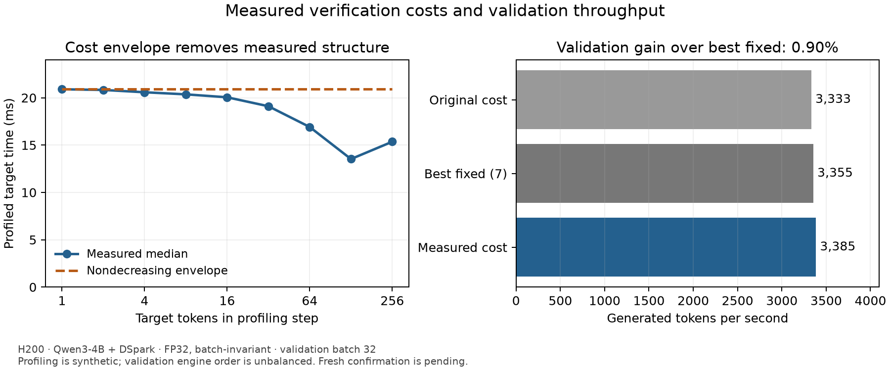

# Adaptive verification for speculative decoding

Experiments by **Angelina Quan** on confidence-based verification lengths for an open-weight LLM.

**Held-out result:** preserving the measured target-cost curve improved throughput **1.25% over the tuned fixed-width baseline** (95% paired batch-and-round bootstrap interval **0.90–1.59%**) and **1.35% over the original adaptive cost model** (**1.07–1.63%**). All 384 prompts matched the ordinary-decoding reference in all 16 sessions. This is a small, confirmed gain in one model/backend/batch-size setting, mainly from conversational prompts. Online calibration has not shown a speed benefit. Earlier 11–15% figures used a weaker comparison in a different numerical configuration.

This repository reproduces **vLLM's existing adaptive-verification implementation** with a released DSpark drafter. It does not claim that the scheduler is new, or that online calibration caused these gains. The broader project asks whether online confidence calibration under workload shifts can improve verification decisions; that contribution remains unproven.

**Earlier v16 correctness failure (preserved):** the fresh 96-prompt run stopped before speculative timing: fixed width 3 at batch 8 differed from ordinary greedy decoding on one prompt (index 88, GSM8K item 901), starting at output token 26. Both outputs reached the 128-token cap. That run established no speedup; the subsequent numerical diagnostics and fresh v26 comparison are reported below. [Preserved outputs](results/v16/incomplete/) · [failed correctness run](https://wandb.ai/aquan-world-model/18657-speculative-pilot/runs/nue79syr).

The diagnostic reproduced the same single mismatch in two complete repeats. At the first divergence, the target log-probability gap between ` a` and ` enough` changes from +0.000469 in ordinary decoding to −0.002220 in speculative execution. This is consistent with numerical sensitivity between execution paths, but does not establish the root cause or satisfy the strict output-equality gate. [Diagnostic outputs and summary](results/v19/).

**Batch-invariant diagnostic:** enabling `VLLM_BATCH_INVARIANT=1` with Triton attention produced identical ordinary and fixed-width-3 outputs on all 96 prompts in both repeats (192 paired comparisons). This resolves the reproduced mismatch for that configuration; it is not a timing result or a check of the adaptive/calibration extension. The changed numerical configuration requires fresh baselines. [Diagnostic results](results/v20/) · [W&B](https://wandb.ai/aquan-world-model/18657-speculative-pilot/runs/f6ty5txm).

**Precision qualification:** the serving studies request FP32 tensors and set `NVIDIA_TF32_OVERRIDE=0`. A later inspection found cached batch-invariant Triton persistent-matmul kernels containing TF32 instructions despite that setting. This is not proof that every cached kernel executes in every timed step; complete kernel attribution remains unaudited. Accordingly, these results must not be described as globally strict IEEE FP32 arithmetic. The frozen comparison uses the same backend settings for all methods and checks token equality against its ordinary-decoding reference. Historical configuration files retain their original requested settings; this note corrects any stronger interpretation of “TF32 disabled.”

## Online calibration pilot (v18)

Under the batch-invariant configuration, fitting on 256 conversational prompts and testing on 144 separate validation prompts gave **no meaningful speed gain** over the fitted frozen calibrator. Updates every 100 verification steps measured **+0.050%** overall; every 25 steps measured **−0.021%**. These are descriptive measurements from three balanced method orders in one engine, not statistically established improvements. The earlier throughput tables use a different numerical configuration and are not directly comparable.

The larger integration gate passed ordinary-decoding output checks on 96 prompts for identity calibration, online updates, and freezing after updates. The pilot also checked every timed output against its fresh ordinary-decoding reference. Online coefficients changed, but observed verification feedback was identical across methods; a separate scheduler-sensitivity diagnostic is needed before interpreting the flat timing as a conclusion about the method.

[Raw pilot records and corrected summary](results/v18/) · [pilot W&B](https://wandb.ai/aquan-world-model/18657-speculative-pilot/runs/h7eip33x) · [corrected audit W&B](https://wandb.ai/aquan-world-model/18657-speculative-pilot/runs/9i93ziph).

The implementation reuses upstream IRLS with the pretrained confidence-head logit. It is not a new optimization algorithm. No confidence interval is reported: online state links successive prompt groups, and repeated timings of the same stream are not independent workload samples. Experimental source files are included under `experiments/`; the calibration runner currently expects the cluster manifest/model-path files and the prerequisite integration artifacts.

## Measured-cost ablation (v24)

The [vLLM team's August 2026 description](https://vllm.ai/blog/2026-08-14-dspark-adaptive-verification) already explains profiled budget selection and acknowledges that measured step costs can genuinely decrease as batches grow. It deliberately enforces monotonicity to smooth the profile. Our experiment tests that existing design choice on this model/backend; the nonmonotonic-cost phenomenon and adaptive scheduler are prior work. The current contribution is an empirical ablation, with a completed held-out confirmation below.




Keeping the measured target-cost curve instead of applying the upstream nondecreasing envelope improved throughput **1.46%** over the original cost model on 144 reused validation prompts at batch 32 (last batch: 16), with identity confidence calibration in both cases. All four balanced timing rounds were positive (+1.36% to +1.55%), and every output matched the batch-invariant ordinary-decoding reference. The change trimmed drafts on 156 of 780 steps, versus no trimming in the original-policy comparison. This is a descriptive single-engine validation result; the subsequent all-width sweep is reported below.

The isolated online-calibration comparison remained negative: online updates were **0.11% slower** than frozen calibration with the same measured cost table. The positive result concerns the cost model, not online calibration.

Diagnostics found stable, nonmonotonic profile measurements: approximately 20.9 ms at one target token, 13.5 ms at 128, and 15.3 ms at 256. Taking a cumulative maximum flattened these into a constant cost. Warmed profiling reproduced the pattern, ruling out a simple cold-start explanation in this run; dummy-profile costs are still not proof of actual serving costs. A separate extreme-confidence intervention changed budgets and preserved outputs, confirming that confidence reaches the scheduler.

[Cost-model results](results/v24/) · [W&B](https://wandb.ai/aquan-world-model/18657-speculative-pilot/runs/hlrshalu) · [profiling diagnostic](results/v23/) · [confidence intervention](results/v22/).

The frozen confirmation plan uses 384 unseen prompts (128 Alpaca, 128 GSM8K, 128 MBPP), four balanced engine orders, and two timed repeats per session. It launched after passing the all-width validation sweep. The confirmation implementation changes only the cost table; per-step calibration scoring and diagnostic budget logging are removed from both adaptive comparators. [Frozen plan](experiments/cost_v26_plan.json) · [manifest](experiments/cost_v26_manifest.json). The original frozen files are preserved; completed results follow below.

An additional CPU-only exploratory check fitted a shared monotone transformation directly to prefix-survival probabilities on 256 old conversational calibration prompts, then scored 128 old chat/math validation prompts before feedback updates. It did not beat frozen baselines on the chat-to-math stream: frozen prefix mapping Brier 0.112531, frozen conditional mapping 0.112511, frozen OPS 0.112444; lower is better. All four online learning rates were worse than frozen OPS on that stream. These are previously examined temperature-1 traces, not fresh tests or greedy-serving speed evidence. [All exploratory scores and fit controls](results/v27/) · [source](experiments/explore_prefix_v27.py). [W&B results and raw-input artifact](https://wandb.ai/aquan-world-model/18657-speculative-pilot/runs/na4ps55l) are uploaded.

## Matched fixed-width sweep (v25)

The same 144 validation prompts, batch size 32 (last batch 16), batch-invariant FP32 configuration, two warmups, and three timing repeats were used for all candidates. All outputs matched the reference. Separate engine order was not balanced, so this selects a baseline rather than establishing significance.

| Method | Tokens/s |
|---|---:|
| Ordinary decoding | 1,174.56 |
| Fixed 1 | 1,742.88 |
| Fixed 2 | 2,401.22 |
| Fixed 3 | 2,879.55 |
| Fixed 4 | 2,658.22 |
| Fixed 5 | 2,742.82 |
| Fixed 6 | 2,927.76 |
| Fixed 7 (best fixed) | 3,355.27 |
| Original cost model | 3,333.25 |
| Measured cost model | 3,385.34 |

[Raw measurements and audited selection](results/v25/). The measured-cost policy passed the launch gate for the frozen 384-prompt confirmation. The held-out result is reported below. Fixed-4 teardown hung after its completed measurements and artifact upload; its worker was terminated to let the same sweep continue. Subsequent runners add bounded shutdown outside timing, and both source versions are preserved.

## Held-out confirmation (v26)

Four balanced engine orders tested the frozen methods on 384 unseen prompts: 128 each from Alpaca, GSM8K, and MBPP. Batch size was 32, with at most 128 generated tokens, one full correctness pass, one warmup, and two timed workload repeats per session. Fixed width 7 was selected using the separate v25 validation sweep. Every generated output was checked against the ordinary-decoding reference; all checks passed.

| Comparator | Tokens/s | Measured-cost throughput gain | 95% batch-and-round bootstrap interval |
|---|---:|---:|---:|
| Ordinary decoding | 1,366.73 | +192.52% | +182.69 to +202.04% |
| Tuned fixed width 7 | 3,948.71 | +1.25% | +0.90 to +1.59% |
| Original adaptive cost model | 3,944.51 | +1.35% | +1.07 to +1.63% |
| Measured-cost variant | 3,997.95 | — | — |

All four round-level gains were positive against each comparator, and both prespecified bootstrap intervals excluded zero, passing the frozen success criterion. The large gain over ordinary decoding is largely existing speculative decoding; the incremental cost-table benefit is about 1%.

The effect varies by domain: relative to tuned fixed width 7, chat improved **2.88%**, math changed **−0.17%**, and code improved **0.31%**. Relative to the original adaptive scheduler, the corresponding changes were **+2.96%, +0.02%, and +0.38%**. These domain numbers are descriptive, not separately established significant gains. MBPP replaces the exhausted HumanEval validation source.

Only four prompt batches per domain and four engine rounds were observed on one H200, one model pair, and one concurrency setting. The intervals do not establish cross-hardware or cross-model generality. FP32 refers to tensor dtype, not guaranteed strict IEEE arithmetic; see the precision qualification above and [cache audit](results/v28/kernel_precision_v28.json). The raw summary retains its original shorthand precision label; this qualification governs its interpretation.

[All 16 raw sessions, summary, and provenance audit](results/v26/) · [W&B audit and artifacts](https://wandb.ai/aquan-world-model/18657-speculative-pilot/runs/vxw4i4v4). [Precision and provenance W&B artifact](https://wandb.ai/aquan-world-model/18657-speculative-pilot/runs/2rrld0p0). Independent local reanalysis exactly matched the remote audit; manifest, source, selection hashes, method orders, and environment metadata were checked. This supports an empirical cost-model ablation, not a new scheduler or an online-calibration benefit.

## Completed results

Throughput is total generated tokens divided by total measured wall time across three timing repetitions. Higher is better. The calls include prefill and decoding; model loading, compilation, and warmup are excluded.

| Concurrent requests | Ordinary decoding | Fixed length 7 | Adaptive verification | Adaptive vs. fixed 7 | Adaptive vs. ordinary |
|---:|---:|---:|---:|---:|---:|
| 1 | 187.43 tok/s | 184.30 tok/s | 212.13 tok/s | **+15.10%** | +13.18% |
| 8 | 567.87 tok/s | 1,010.31 tok/s | 1,107.50 tok/s | **+9.62%** | +95.03% |
| 32 | 1,885.48 tok/s | 1,641.21 tok/s | 1,824.39 tok/s | **+11.16%** | **−3.24%** |

All batch sizes are shown, including the negative comparison with ordinary decoding at batch 32. The first fixed-7 timing at batch 8 was slower than the other two (1.078 s versus about 0.910 s); it is retained in the table. Thus the pooled +9.62% at batch 8 should not be read as a stable effect size.

- [Ordinary-decoding W&B run](https://wandb.ai/aquan-world-model/18657-speculative-pilot/runs/hossc6i8)
- [Fixed-7 W&B run](https://wandb.ai/aquan-world-model/18657-speculative-pilot/runs/6pb6wa6c)
- [Adaptive-verification W&B run](https://wandb.ai/aquan-world-model/18657-speculative-pilot/runs/itgkdqhi)
- [GPU sampling-correctness W&B run](https://wandb.ai/aquan-world-model/18657-speculative-pilot/runs/hvf8or17)
- [Raw measurements and output token IDs](results/v14/raw/) · [computed summary](results/v14/summary.json)

## Stronger baseline sweep (v15)

All methods processed the same 32 validation prompts at each batch size, with two full-workload warmups and three timing repetitions. All nine methods matched the ordinary-decoding output tokens. Fixed widths were selected on these validation measurements only; engine order was not balanced, so this sweep is for selection rather than significance testing.

| Batch | Best fixed width | Best fixed throughput | Adaptive throughput | Adaptive vs. best fixed |
|---:|---:|---:|---:|---:|
| 1 | 5 | 337.41 tok/s | 298.17 tok/s | **−11.63%** |
| 8 | 3 | 1,056.36 tok/s | 1,079.83 tok/s | **+2.22%** |
| 32 | 1 | 2,039.42 tok/s | 1,811.65 tok/s | **−11.17%** |

This is evidence that the original fixed-7 comparison was insufficient to establish a general advantage. It is not evidence of an improvement from online confidence-head recalibration. The smaller configured widths also reduce drafting work; adaptive verification at width 7 only trims verification.

[All raw v15 measurements](results/v15/raw/) · [full summary and W&B links](results/v15/summary.json)

```bash
python experiments/analyze_serving_v15.py results/v15/raw --output /tmp/serving-v15-audit.json
```

## What is the idea?

Speculative decoding generates draft tokens with a smaller model, then checks them with the target model. Verifying every draft position can waste compute when later tokens are unlikely to survive rejection.

The released drafter has a pretrained confidence head. vLLM's adaptive scheduler uses estimated prefix-survival probabilities and profiled execution costs to choose a verification budget and allocate slots across requests. This changes **how much to verify after drafting**; it does not magically know an optimal draft length in advance or eliminate all drafting work. See the [vLLM adaptive-verification documentation](https://docs.vllm.ai/en/stable/features/speculative_decoding/adaptive_verification/).

## Setup and correctness

The completed probe used:

- NVIDIA H200, driver 580.178.04; vLLM 0.33.0; PyTorch 2.14.0+cu130. [Full installed package list](docs/environment-v14.txt).
- [Qwen3-4B](https://huggingface.co/Qwen/Qwen3-4B), revision `1cfa9a7208912126459214e8b04321603b3df60c`.
- [DSpark Qwen3-4B block-7 drafter](https://huggingface.co/deepseek-ai/dspark_qwen3_4b_block7), revision `3457dff1417cb84927f6098a5fcb7cee85c934b7`.
- Released checkpoint weights promoted to **FP32**, TF32 disabled, Triton attention, CUDA graphs, prefix caching disabled, non-thinking chat template.
- Greedy generation, a 128-token output cap, and batches drawn from 32 validation prompts interleaved across Alpaca, GSM8K, and HumanEval. The original probe uses the first 1, 8, or 32 prompts at the corresponding batch size.

Two checks passed before timing conclusions:

1. Fixed-7 and adaptive generation matched ordinary greedy decoding token-for-token at each evaluated batch size. Repeated timed outputs matched as well. These output IDs are committed so this comparison can be independently checked.
2. The actual installed GPU rejection kernel was tested against a known three-state Markov target with 20,000 draws each for fixed and causally chosen variable proposal lengths. Total-variation deviations were 0.01325 and 0.01385, with maximum standardized cell errors of 2.17 and 2.02. Both passed the predeclared numerical thresholds.

These checks have limits: greedy agreement is not a proof of full-model stochastic equivalence; the finite-state kernel test does not validate every cache or scheduler path. Earlier work with a different BF16 backend failed a numerical check, so these FP32 results must not be relabeled as BF16 results.

## Reproduce the cost experiments

After installing the pinned environment, downloading the models with `scripts/download_models.py`, and configuring W&B, use a fresh output directory:

```bash
python scripts/run_cost_study.py --phase validation --run-dir .local/cost-validation-1
python scripts/run_cost_study.py --phase confirmation --run-dir .local/cost-confirmation-1
```

The confirmation command reproduces the published fixed-width selection on the frozen prompts; these prompts are not a new unseen test for later research. Each phase runs independently in its own directory. The validation runner requires its outputs to match the published batch-invariant reference; another GPU/backend may fail that numerical gate. Set `WANDB_MODE=offline` to retain logs locally. `--stage-only` copies inputs without starting inference or downloading anything; existing run directories are rejected. Staging and overwrite protection have been checked locally; the complete GPU run of this packaging wrapper has not been tested separately from the underlying cluster scripts.

## Reproduce

Use a CUDA-capable Linux GPU environment with enough memory for this FP32 configuration. The measured configuration was an H200; other hardware can change the ranking.

```bash
python -m venv .venv
source .venv/bin/activate
pip install -r requirements.txt
python scripts/download_models.py
wandb login
bash scripts/run_probe.sh v14
```

The experiment scripts use the original W&B entity/project, `aquan-world-model/18657-speculative-pilot`. If running under another account, change the `wandb.init` entity/project in the scripts, or use `WANDB_MODE=offline`. No credentials are included. Model paths are created locally and ignored by Git.

The wrapper puts temporary files and caches in `.local/`; set `SERVING_SCRATCH` to a suitable local disk to override it. Outputs go to `$SERVING_SCRATCH/probe-results`. These wrapper paths differ from the original cluster-specific launcher, but preserve its model and inference settings; inference initialization is excluded from timing.

To audit the committed measurements without a GPU or extra packages:

```bash
python scripts/verify_results.py
```

## Follow-up experiments and current status

The v15 validation sweep is completed and audited above. The repository also includes the v16 follow-up code; no held-out result is claimed yet.

- **v15 (completed):** run every fixed proposal width from 1 through 7, ordinary decoding, and adaptive verification. Evaluate all 32 validation prompts at every batch size, rather than one prompt at batch 1. A shorter configured proposal width may change the parallel drafter computation, not only truncate verification.
- **v16:** 96 frozen fresh prompts, 32 per domain; batch 8 is the predeclared primary comparison, with batches 1 and 32 secondary. Choose fixed widths using v15 validation only. Compare methods in three balanced engine-order rounds and retain per-batch timings for paired analysis. The driver declines to launch fresh evaluation if adaptive fails to beat both validation comparators at the primary batch size.

```bash
bash scripts/run_probe.sh v15
python experiments/analyze_serving_v15.py \
  .local/probe-results-v15 --output .local/serving_v15_summary.json
# After inspecting validation and preserving the frozen test plan:
bash scripts/run_probe.sh v16
```

The wrapper retains the cache and numerical settings across these experiments. The held-out runner and manifest are included for transparency, but no held-out performance result is claimed in this revision. The shell wrapper assumes the default `.local` output directory in the analysis example above; substitute your `SERVING_SCRATCH` path if you changed it.

## Sources and attribution

Inference and adaptive scheduling are provided by [vLLM](https://github.com/vllm-project/vllm). The released drafter and pretrained confidence head come from [DeepSpec](https://github.com/deepseek-ai/DeepSpec). The prompt selection uses the Alpaca, GSM8K, and HumanEval files in DeepSpec's evaluation datasets, from commit `005e03b81cec38b7da6399833d609ee89a2587f2`. Dataset hashes and held-out selection provenance are recorded in [the v16 plan](experiments/serving_v16_plan.json). Upstream model, software, and dataset licenses remain applicable.
