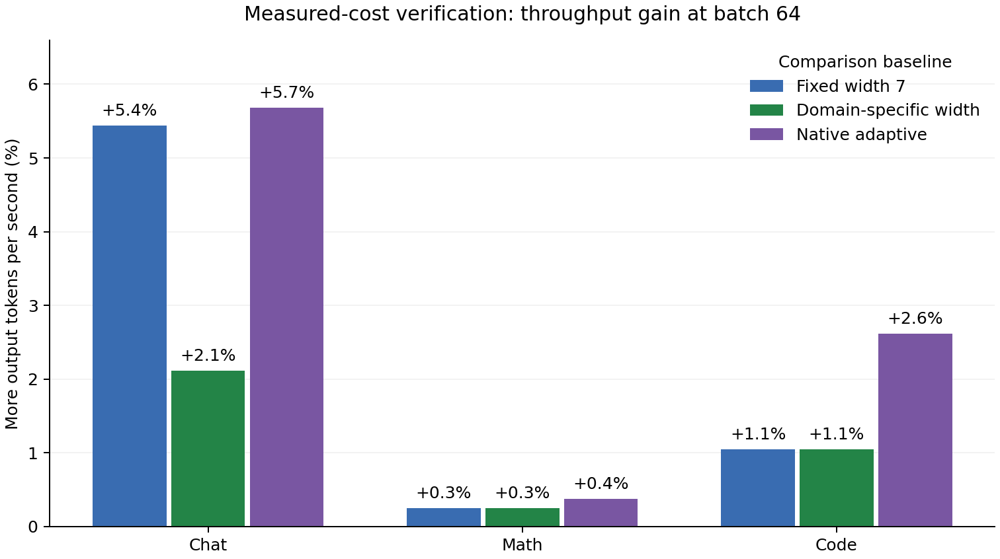

# Using Measured GPU Costs to Speed Up Speculative Decoding

[Core implementation](src/verification_costs.py) · [Benchmark and analysis code](src/) · [Paper](paper/paper.pdf)

**Research question.** Does enforcing a nondecreasing GPU timing curve lead a speculative decoder to choose slower verification budgets? The native vLLM scheduler uses a running maximum over profiled target times. We replace that running maximum with the median measured at each captured size. The confidence head, token verifier, and allocation rule stay fixed.

**Setting.** Qwen3-4B with the seven-token DSpark drafter on one H200, using greedy decoding and a 128-token output cap. The batch-64 comparison used 768 held-out prompts, equally divided among conversation, math, and code. Each method ran in four balanced engine orders, with two timed passes after warmup. All timed outputs matched the ordinary greedy reference.

**Main result.** Using measured GPU costs increased warmed-up throughput over native adaptive verification by **1.35% at batch 32** (384 held-out prompts, 95% paired bootstrap interval 1.07% to 1.63%) and **3.17% at batch 64** (768 held-out prompts, 1.13% to 5.45%). At batch 64, throughput rose from 6,059 to 6,251 tokens/s. Timing excludes startup and profiling.



Each bar compares **measured-cost verification** with the baseline named in the legend on the same 256 prompts. For example, **+5.7%** means the measured-cost scheduler generated **5.7% more output tokens per second than native adaptive verification on chat**. Against that same baseline, the gains were +0.4% on math and +2.6% on code. The domain-specific baseline uses width 3 for chat and width 7 for math and code, which is why the two fixed-width bars coincide for math and code. These are descriptive per-domain estimates.

[Course paper](paper/paper.pdf) · [LaTeX](paper/main.tex) · [Cost-table implementation](src/verification_costs.py) · [Research history](HISTORY.md)

**Additional batch sizes.** On the same 768 prompts, the [batch-8](results/batch8_summary.json) and [batch-16](results/batch16_summary.json) estimates were +0.17% and +0.015%. Both intervals included zero.

## Reproduce

From the repository root, recompute both published summaries from the saved session records and regenerate the graph on CPU:

```sh
python -m pip install numpy matplotlib
python scripts/verify.py
```

For a fresh timing run, use an H200 with the paper's vLLM 0.33.0 GPU environment (PyTorch 2.14.0). The runner downloads the pinned checkpoints and stages each experiment in a new directory. W&B logging defaults to offline.

```sh
python -m pip install -r requirements.txt
python scripts/run_cost_study.py --batch 64 --run-dir /tmp/cost-batch64
python scripts/run_cost_study.py --batch 32 --run-dir /tmp/cost-batch32
```

The [small-batch replication archive](results/small_batch_replication.zip) contains the frozen inputs, benchmark code, analysis, and session records. After extracting it, run `python batch8/analyze.py batch8 --output batch8.json` and repeat with `batch16`.
